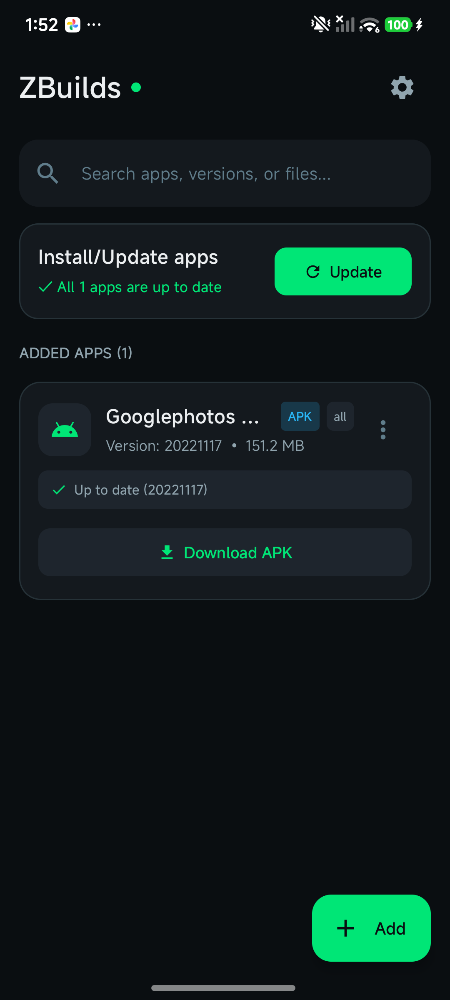
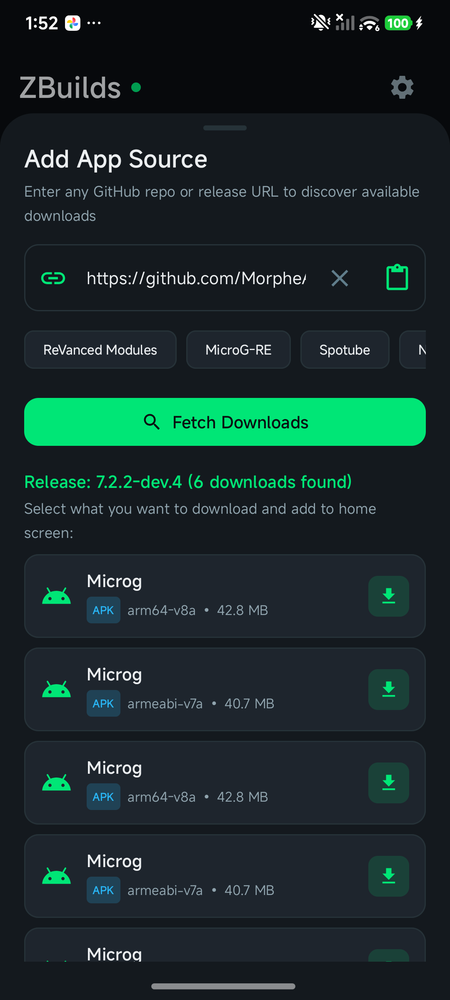
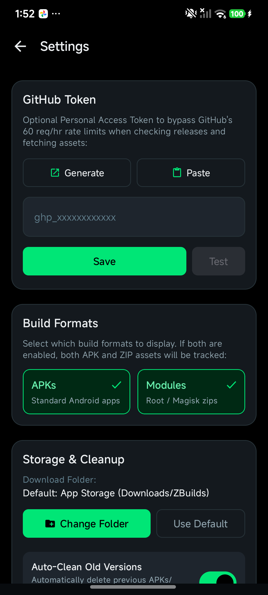
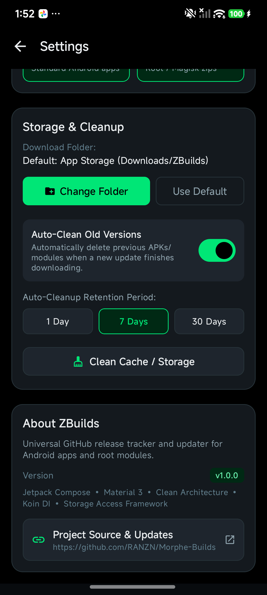

# ZBuilds ⚡

[](https://github.com/RANZN/Morphe-Builds/actions/workflows/release.yml)
[](https://kotlinlang.org)
[](https://developer.android.com/jetpack/compose)
[](https://developer.android.com/topic/architecture)
[](https://insert-koin.io/)
[](https://android.com)
[](LICENSE)

**ZBuilds** is a modern, high-performance Android utility engineered to discover, track, update, and manage GitHub releases for Android apps (`.apk`) and Magisk/KernelSU root modules (`.zip`). 

Built strictly following **Clean Architecture** principles and **MVI (Model-View-Intent)** with **Jetpack Compose**, **Koin**, and an **AMOLED Pure-Black Design System**.

---

## 📱 Screenshots

| Home & Updates | Add App Source | GitHub Token Settings | Storage & Retention |
|:---:|:---:|:---:|:---:|
|  |  |  |  |

---

## ✨ Features

- **Multi-Format Build Support**: Track both standard Android APKs (`.apk`) and Magisk / KernelSU / APatch root modules (`.zip`) with dedicated badge indicators.
- **Dynamic Format Filtering**: Toggle visibility between APKs and Modules independently in Settings to filter tracked lists and asset discovery sheets.
- **CPU Architecture Auto-Detection**: Automatically detects device ABI (`arm64-v8a`, `armeabi-v7a`, `x86_64`) and tags assets for one-tap matching.
- **GitHub Rate Limit Bypass**:
  - Secure GitHub Personal Access Token integration to bypass GitHub's 60 req/hr anonymous limit (up to 5,000 req/hr).
  - **Generate** action: Directly opens GitHub token creation page with pre-filled scopes (`public_repo`).
  - **Paste** action: Instantly reads token from the clipboard.
  - **Masked Token Security**: Never displays the raw token in plain text; automatically masks input with bullet obfuscation, eye-toggle visibility, and `••••••••••••${last4}` verification.
- **Storage Access Framework (SAF)**: Choose custom download folders anywhere on internal or external storage (`content://` URI tree persistence).
- **Automated Cache & Storage Cleanup**:
  - Configurable retention periods (1 Day, 7 Days, 30 Days).
  - Background cleanup scheduler powered by Android WorkManager.
  - One-tap immediate storage cleanup with snackbar feedback.
- **AMOLED Pure-Black UI**: Beautiful Jetpack Compose Material 3 dark interface with neon emerald green accents (`#00E676`) and zero battery drain on OLED screens.

---

## 🏛️ Clean Architecture & Tech Stack

The project adheres to strict **Clean Architecture** with a unidirectional data flow (**MVI**):

```
                        ┌─────────────────────────────────────────┐
                        │              Presentation               │
                        │   (Jetpack Compose, ViewModels, MVI)    │
                        └────────────────────┬────────────────────┘
                                             │ depends on
                        ┌────────────────────▼────────────────────┐
                        │                 Domain                  │
                        │    (Pure Kotlin UseCases, Models,       │
                        │         Repository Interfaces)          │
                        └────────────────────▲────────────────────┘
                                             │ implements
                        ┌────────────────────┴────────────────────┐
                        │                  Data                   │
                        │   (Retrofit, OkHttp, DataStore, SAF,    │
                        │        WorkManager, Room/Memory)        │
                        └─────────────────────────────────────────┘
```

- **Pure Domain Layer**: Contains no Android framework dependencies (`Context`, `Activity`, etc.). All platform-specific operations (intents, package installation, clipboard, SAF folder pickers) remain in Presentation or Data.
- **Dependency Injection**: 100% powered by **Koin** (`koin-android`, `koin-androidx-compose`).
- **Networking**: **Retrofit 2** & **OkHttp 3** with custom `AuthInterceptor` injecting the user's GitHub Token.
- **Persistence**: **Jetpack DataStore Preferences** for encrypted/atomic settings persistence.
- **Background Tasks**: **Android WorkManager** with `CoroutineWorker` for periodic retention cleanup.

---

## 📁 Project Structure

```
com.ranzan.zbuilds/
├── core/
│   ├── mvi/             # UiState, UiEvent, UiEffect, BaseViewModel
│   └── utils/           # Architecture and format detection helpers
├── data/
│   ├── local/           # DataStore preferences & AppDatabase
│   ├── remote/          # GitHub API, Retrofit client, AuthInterceptor, parser
│   ├── repository/      # SettingsRepositoryImpl & ReleaseRepositoryImpl
│   └── scheduler/       # WorkManager cleanup worker implementation
├── domain/
│   ├── model/           # AppBuild, Release, AppSettings, AppType
│   ├── repository/      # ReleaseRepository & SettingsRepository contracts
│   └── usecase/         # Single-responsibility UseCases (GetSettings, SaveToken, etc.)
├── di/
│   └── AppModule.kt     # Koin DI definitions (network, data, domain, viewmodels)
└── ui/
    ├── home/            # HomeScreen, HomeViewModel, HomeContract, AddAppSourceSheet
    ├── settings/        # SettingsScreen, SettingsViewModel, SettingsContract
    ├── theme/           # Color, Theme, Type (AMOLED palette)
    └── util/            # FileIntentHelper (pure UI context intent dispatcher)
```

---

## 🚀 Automated CI/CD (`.github/workflows/release.yml`)

The repository includes a production-grade GitHub Actions release workflow:
- **Triggers**: On push to `master`/`main`, git tags (`v*`), manual trigger (`workflow_dispatch`), or release publication.
- **JDK Toolchain**: Sets up Java 17 Temurin with Gradle build cache (`setup-gradle@v4`).
- **Keystore Detection**: Automatically detects if `KEYSTORE_BASE64` secret exists:
  - If present: compiles release variant and signs APK with `r0adkll/sign-android-release@v1`.
  - If absent: compiles debug variant for instant CI validation.
- **Automated GitHub Release**: Packages APK as `ZBuilds-v${VERSION}.apk` and attaches it directly to a new GitHub Release.

---

## 🛠️ Building & Running

### Prerequisites
- Android Studio Ladybug / Meerkat or newer
- JDK 17
- Android SDK 36 (minSdk 24, targetSdk 36)

### Clone & Build
```bash
# Clone the repository
git clone https://github.com/RANZN/Morphe-Builds.git
cd Morphe-Builds

# Build debug APK
./gradlew assembleDebug

# Install directly to connected device
./gradlew installDebug
```

---

## 📄 License

```text
Copyright 2026 Ranjan

Licensed under the Apache License, Version 2.0 (the "License");
you may not use this file except in compliance with the License.
You may obtain a copy of the License at

    http://www.apache.org/licenses/LICENSE-2.0
```
